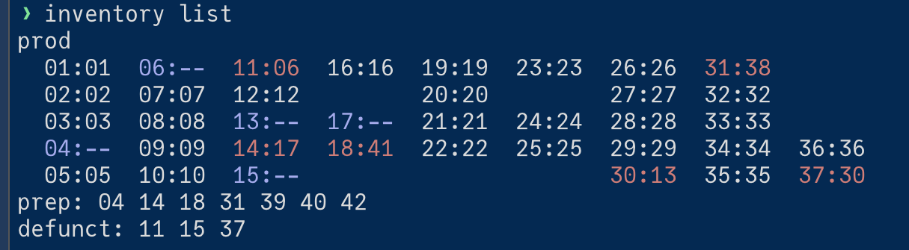

# How to remap nodes in R2lab

When a node is broken, you want to replace it with another spare node.
This requires root access on faraday and preplab, and can be achieved as follows.

On prod, most of the time there is no discrepancy, i.e. node *X* sits on slot
*X* in the chamber. However when a spare node needs to be deployed instead, the
testbed needs to be reconfigured, and this is when you will need `inventory`.

## Background

The tools in this directory configure the testbed deployed on `faraday.inria.fr`
(and its sibling, the preplab), mostly in terms of both:

* `dnsmasq`, that serves DHCP and DNS to the nodes, and
* `rhubarbe`, that offers higher level tools for managing nodes status and images  
  specifically the `install` command (see below) updates `all_scope`, which affects the behaviour of `rhubarbe --all`

### installation / requirements

```bash
# install (needs uv)
uv sync

# see overview
uv run inventory help
```

## A typical session

Everything should be doable through a single command `inventory`  
Note that the source code is in r2lab_inventory.py, and `inventory` is the script that `uv sync` installs from `pyproject.toml`; run it as `uv run inventory`, or activate `.venv`

as an example to illustrate a typical workflow, let's assuming that

- node 27, that was in slot 27 in prod, is broken
- and we want to replace it with node 42, formerly in the preplab

```terminal
cd r2lab-inventory

# always a good idea
git pull

# activate the venv - this can be done automatically for you with direnv
source .venv/bin/activate

# you can't move a node to a non-empty slot
# so first free the slot, then fill it
inventory move 27 preplab
inventory move 42 prod:27

# optionally, maintain the note field
inventory set-note 27 "broken CMC"

# check what's expected to be in prod
inventory list --prod

# check what will be generated
inventory generate

# then commit and push the changes into the repo, e.g.
git add boxes.yaml
git commit -m "replaced node 27 in slot 27 with node 42"
git push
# nothing else to do: run-updates on faraday and on the preplab
# catches the push within 10 minutes, and calls deploy/update.sh,
# that installs the files and restarts the services
```

---

***IMPORTANT NOTE about propagation***  
the new configuration is applied by `run-updates` on each box, which runs every 10 minutes, and `dnsmasq` may take a bit longer to settle; so please be patient

---

### the `list` command

```bash
inventory list [--prod|--prep|--defunct] [-v]`
```

shows where the nodes are. By default it draws the room as in the livemap; each cell is the ceiling slot, then the physical number of the node deployed there, or `--` for an empty slot. On a terminal, the cells where the node differs from the slot number (like `11:06`) are shown in light red, and the empty slots in light blue. This is followed by the nodes in the preplab and the defunct ones (colored in a terminal):



With `-v` you get one line per node instead, with its note field.

### the `move` command

```
inventory move PHY DESTINATION`
```

where the destination is `prod:N`, `preplab` or `defunct`. The free-form note of a node is set with `inventory set-note PHY NOTE` (an empty note removes it).

It fails if the destination slot is busy; so to replace the node in slot 27, first move it out of the way (to `preplab` or `defunct`), and then move the new one in. It also fails on a duplicate slot or MAC, and `list` / `generate` warn about empty prod slots.

### `generate` and `install`

```bash
inventory generate [--prod|--prep]
```

only computes the files locally, in the current directory:

```terminal
$ inventory generate --prod
WARNING: empty prod slots: 04 06 13 15 17
(Over)wrote prod-inventory-nodes.yaml from boxes.yaml
(Over)wrote prod-dnsmasq              from boxes.yaml
(Over)wrote prod-hosts                from boxes.yaml
```

The warning lists the prod slots that no node is deployed in.

```bash
inventory install --prod|--prep [--root DIR]
```

does a `generate`, then installs the files **on the box where it runs**: `/etc/rhubarbe/inventory-*.yaml` (the phones, pdus and relays ones only for prod, these being copies of `inventory-{phones,pdus,relays}.yaml` with a warning header), the `dnsmasq` configuration and `/etc/hosts`. It also updates `all_scope` in `/etc/rhubarbe/rhubarbe.conf.local`, to reflect the nodes that are actually there: for faraday that is `all_scope=1-37,~4,~6` where the `~` ones are the empty slots, and for the preplab the list of nodes that sit there.

It restarts nothing, and it is not meant to be run by hand: it is called by `deploy/update.sh`, that `run-updates` runs after each push. That script figures out whether it is on prod or on the preplab (prod is where `monitorphones` and `monitorpdus` are enabled), runs `inventory install`, and then restarts `NetworkManager` (which is what runs `dnsmasq`) and the `rhubarbe` services that are enabled. Everything is recomputed and restarted every time, on purpose, to keep things simple.

`--root` installs under another directory instead of `/`, for testing.

### more subcommands

see full list with

```bash
inventory help
```

## about `boxes.yaml`

The source of truth for where the boxes are is `boxes.yaml`. You should ***not need to edit*** this
file by hand; it contains one entry per physical node (the number on the label
glued to the node) like this:

```yaml
42:
  mac: "00:03:1d:0e:03:5b"
  wlan: ["7c:c3:a1:a8:26:9e", "7c:c3:a1:a8:1c:2a"]
  where: {prod: 27}      # or: prep | defunct
  note: "replaced fit27 2025-10"
```

The location of a node, `where`, is one of

* `{prod: N}` - deployed in faraday, at ceiling slot `N` (1..37)
* `prep` - in the preplab (a.k.a. v0)
* `defunct` - out of order

## about `positions.yaml`

`boxes.yaml` is about the hardware boxes, that can be moved around. What belongs
to a *position* in the chamber, whatever box sits there (SDR, duplexer, antennas,
photos, ...), goes in `positions.yaml`. This one is edited by hand; it maps a slot
(1..37) to a free-form mapping:

```yaml
12:
  usrp: {type: b205, duplexer: 2-5G, logo: antenna}
  data_interface: true
  images: [2017-12/fit12.jpg]
```

The tool makes no assumption on what is in there: each mapping is copied as-is, under
the key `static`, in the entry of that slot in the generated `*-inventory-nodes.yaml`;
`monitornodes` then exposes it as-is to the sidecar and the web UI. Only the slot
numbers are checked. The file is optional, and it does not apply to the preplab, where
nodes are exposed by physical number.

***Careful when you first push a `static` entry***: the `rhubarbe` on the gateway
needs to be recent enough to ignore it, or it will fail on the inventory.
